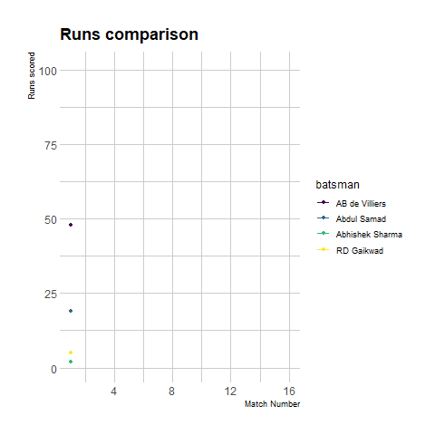
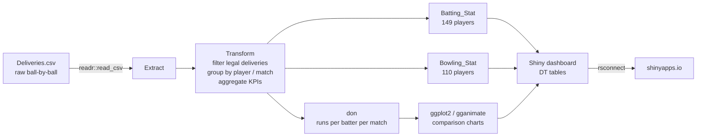

# IPL 2021 Player Performance Analytics Dashboard

**An end-to-end analytics project that turns 14,000+ rows of raw ball-by-ball cricket data into an interactive R Shiny dashboard of batting and bowling KPIs.**


**Live app:** https://mageshwaran.shinyapps.io/IndianPremiereLeague/



---

## Overview

| | |
|---|---|
| **Business question** | Which players performed best in IPL 2021, and how do players compare match by match? |
| **Data** | 14,412 deliveries and 60 matches from the 2021 Indian Premier League season (8 teams, 149 batters, 110 bowlers) |
| **What I built** | A data pipeline that cleans and aggregates the raw data into player-level stats, plus a 3-tab Shiny dashboard for self-service analysis |
| **Tools** | R, tidyverse (dplyr, readr, stringr), ggplot2, gganimate, Shiny, shinydashboard, DT, shinyWidgets |
| **Role** | Solo project: data sourcing, cleaning, metric design, visualization and deployment |

## Key results

- Built **20 player KPIs** (10 batting, 10 bowling) from a single fact table of raw deliveries.
- The derived numbers match the official 2021 season leaders, which validates the transformation logic:
  - **Top run-scorer:** RD Gaikwad, 635 runs
  - **Next four:** F du Plessis 634, KL Rahul 626, Shikhar Dhawan 587, GJ Maxwell 513
  - **Top wicket-taker:** HV Patel, 32 wickets (run-outs excluded, since they aren't credited to the bowler)
- Deployed the dashboard to **shinyapps.io**, so non-technical users can sort and filter player stats and compare any four batters side by side.

## Dashboard features

| Tab | What it shows |
|---|---|
| **Batting** | Searchable, sortable table: matches, runs, outs, not-outs, balls faced, high score, average, strike rate, 4s, 6s |
| **Bowling** | Searchable, sortable table: matches, runs conceded, wickets, balls, overs, most runs in an over, best match, average, strike rate, economy |
| **Compare** | Pick any 4 batters (or toggle **Random**) to see a match-by-match runs line chart and a circular (polar) bar chart |

## Data sources

| Source | File | Grain | Rows | Key fields |
|---|---|---|---|---|
| Kaggle: IPL 2021 ball-by-ball dataset | `dataset/Deliveries.csv` | One row per delivery | 14,412 | match_no, inning, over, ball, batsman, bowler, batsman_run, extra_run, extra_type, is_wicket, dismissal_type |
| Kaggle: IPL 2021 match results | `dataset/IPL Matches.csv` | One row per match | 60 | match_no, date, team1, team2, venue, toss, decision, winner, mom |

## Data pipeline



## Source-to-target mapping (STTM)

**Target: `Batting_Stat`** (grain: one row per batter for the season)

| Target column | Source table.column | Transformation / business rule |
|---|---|---|
| batsman | Deliveries.batsman | Group-by key |
| Matches_Played | Deliveries.match_no | `COUNT(DISTINCT match_no)` per batter |
| Runs | Deliveries.batsman_run | `SUM(batsman_run)` (extras excluded) |
| Out | Deliveries.is_wicket | Count of distinct matches where `is_wicket = 1` |
| NO (not outs) | derived | `Matches_Played - Out` |
| Ball_Faced | Deliveries.extra_run, extra_type | Count of legal balls: `extra_run = 0 OR extra_type = 'lb'` (wides and no-balls excluded) |
| HS (high score) | Deliveries.batsman_run | `MAX(SUM(batsman_run))` over each match |
| Average | derived | `ROUND(Runs / Out, 2)` |
| SR (strike rate) | derived | `ROUND(Runs / Ball_Faced * 100, 2)` |
| Four / Six | Deliveries.batsman_run | Count of balls where `batsman_run = 4` / `= 6` |
| (nulls) | — | Players with no outs, 4s or 6s are filled with `0` after full outer joins |

**Target: `Bowling_Stat`** (grain: one row per bowler for the season)

| Target column | Source table.column | Transformation / business rule |
|---|---|---|
| bowler | Deliveries.bowler | Group-by key |
| Match | Deliveries.match_no | `COUNT(DISTINCT match_no)` per bowler |
| Runs | Deliveries.batsman_run, extra_run | `SUM(batsman_run + extra_run)`, excluding leg-byes (not charged to the bowler) |
| Wickets | Deliveries.is_wicket, dismissal_type | Count where `is_wicket = 1 AND dismissal_type <> 'runout'` |
| Balls | Deliveries.extra_run, extra_type | Count of deliveries bowled |
| Over | Deliveries.extra_run | Legal balls in cricket notation: `balls %/% 6` + "." + `balls %% 6` |
| Over_Runs | Deliveries.over | Most runs conceded in a single over |
| Best | Deliveries.is_wicket | Most wickets in a single match |
| Average / SR / Economy | derived | `Runs / Wickets`, `Balls / Wickets`, `Runs / Over` |

**Target: `don`** (grain: one row per batter per match; feeds the comparison charts)

| Target column | Source | Rule |
|---|---|---|
| batsman, match_no | Deliveries | Group-by keys |
| Runs | Deliveries.batsman_run | `SUM(batsman_run)` |
| match_id | derived | Running match number for each batter (`seq_len`), used as the x-axis |

## Repository structure

```
├── app.R                       # Full Shiny app: ETL + UI + server (deployed version)
├── Import clean and manage.rmd # Step 1 – data import, cleaning, KPI aggregation
├── TableFunction.Rmd           # Step 2 – builds the per-match runs table
├── CreatingFunctions.R         # Step 3 – reusable comparison functions
├── Graphical Displays.Rmd      # Step 4 – circular bar chart + animated line charts
├── dataset/                    # Raw source CSVs
├── animate/, output.gif        # Rendered animations
└── rsconnect/                  # shinyapps.io deployment config
```

## How to run locally

```r
install.packages(c("tidyverse", "shiny", "shinydashboard", "DT", "shinyWidgets",
                   "gganimate", "gifski", "hrbrthemes", "viridis", "babynames"))
shiny::runApp("app.R")
```

## Skills demonstrated

`Data Analysis` · `ETL` · `Data Cleaning & Wrangling` · `Data Transformation` · `KPI Design` · `Data Aggregation` · `SQL-style joins (dplyr)` · `Data Validation` · `Data Visualization` · `Interactive Dashboards` · `R Shiny` · `ggplot2` · `Storytelling with Data` · `Deployment (shinyapps.io)` · `Sports Analytics`

## Possible improvements

- Compute economy from total balls (`Runs / (Balls / 6)`) rather than the cricket "overs.balls" notation.
- Join `IPL Matches.csv` to add team, venue and toss-decision analysis.
- Add bowler comparison charts to match the batter comparison tab.

---

**Author:** Mageshwaran Anbazhagan · [GitHub](https://github.com/MageshwaranA)
